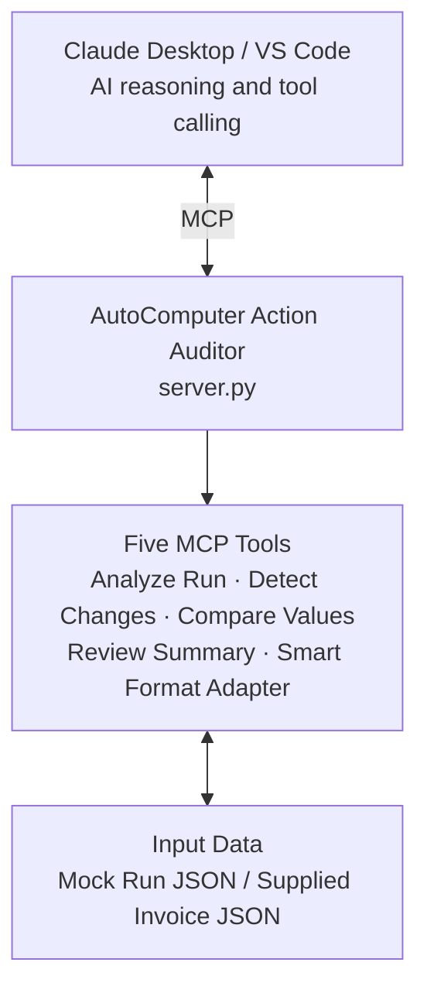

# AutoComputer Action Auditor

An MCP server prototype that provides reusable tools for reviewing
automation runs and adapting invoice data formats.


## The problem and the gap

AI agents can use a computer to complete tasks, but business workflows
often involve extra checks and data formats that vary between systems.
An agent may be able to read a spreadsheet or inspect an automation log,
yet each application can label fields differently or require a separate
review process.

This project explores how MCP can fill part of that gap by exposing
small, reusable tools through a standard interface. Instead of
rebuilding the same helper logic inside every agent, an MCP-compatible
host can call the tools when needed.

The prototype focuses on two capabilities:

-   Reviewing a recorded automation run and highlighting changes that
    may need human attention.
-   Mapping known invoice column-name variations to a standard set of
    fields.

These capabilities are useful as a demonstration of the approach; they
do not imply that AutoComputer lacks similar features.

## How MCP helps

MCP is a standard way for an AI application (the **host**) to discover
and call external tools. Here, Claude Desktop or a compatible VS Code
setup can call the Python functions registered by `server.py`.

The host chooses when to call a tool. The MCP server runs the
corresponding function and returns its result. The server does not
replace the AI agent, and it does not independently approve business
actions.

## Features

  -----------------------------------------------------------------------
  MCP tool                            What it does
  ----------------------------------- -----------------------------------
  `analyze_automation_run_tool`       Returns the recorded actions for a
                                      run.

  `detect_suspicious_changes_tool`    Flags unusually large numeric
                                      changes for review.

  `compare_before_after_tool`         Compares values before and after an
                                      action.

  `generate_review_summary_tool`      Summarizes the run and its review
                                      items.

  `smart_format_adapter_tool`         Maps supported column names to
                                      standard invoice fields.
  -----------------------------------------------------------------------

A suspicious-change flag is a signal to investigate, not proof of an
error. A successful action status also does not prove that the resulting
data is correct.

## Tech stack

  -----------------------------------------------------------------------
  Technology                          Use in this project
  ----------------------------------- -----------------------------------
  Python                              Implements the MCP tools and data
                                      processing.

  MCP Python SDK                      Exposes the tools to compatible
                                      hosts.

  `uv`                                Manages the project environment and
                                      installs dependencies from project
                                      configuration.

  JSON                                Stores mock automation runs and
                                      supplies sample input to the format
                                      adapter.

  Claude Desktop / VS Code            MCP hosts used to connect to and
                                      test the server.
  -----------------------------------------------------------------------

## System design



### Request flow

1.  The user asks the host to inspect an automation run or adapt invoice
    data.
2.  The host calls the relevant MCP tool.
3.  The server passes the input to the Python function.
4.  The tool processes mock data or supplied JSON input.
5.  The result is returned to the host for the user to review.

## Project structure

``` text
autocomputer-action-auditor/
├── .vscode/
│   └── mcp.json
├── mock_data/
│   └── automation_runs/
│       └── run_001.json
├── services/
│   └── data_loader.py
├── src/
│   └── autocomputer_action_auditor/
│       └── __init__.py
├── tools/
│   ├── analyze_run.py
│   ├── compare_changes.py
│   ├── detect_changes.py
│   ├── review_summary.py
│   └── smart_format_adapter.py
├── server.py
├── pyproject.toml
├── uv.lock
└── README.md
```

-   `server.py` registers and starts the MCP server.
-   `tools/` contains the five tool implementations.
-   `services/data_loader.py` loads and validates mock automation-run
    data.
-   `mock_data/` contains sample input for automation-run tools.
-   `.vscode/mcp.json` configures the server for VS Code.
-   `pyproject.toml` defines project metadata and dependencies.
-   `uv.lock` records resolved dependency versions.
-   `src/` is retained in the current project layout.

